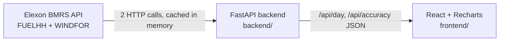

# Wind Forecast Monitor

A web app for a GB energy supplier's day-ahead trading team. It shows **the wind forecast that was actually
available when the day-ahead purchase decision had to be made**, and **how wrong that forecast turned out to
be**, so the team can size how much extra power to buy.

**Live app:** https://qx7wv.vercel.app

Scope (as specified): national GB wind only, Elexon BMRS data only, purchase decisions made in **January 2026**.

---

## What the app does

| View | Answers |
|---|---|
| **Delivery day** | For a chosen delivery day: the forecast available at the decision deadline vs actual generation, hour by hour, with a *likely range* band (P10–P90) and the hourly table. |
| **Forecast accuracy** | Across all January decisions: MAE, RMSE, bias, the backup needed to cover 9 in 10 hours, error distribution, error by hour of day, and how error grows with forecast lead time. |

The **decision deadline** is selectable: EPEX day-ahead auction (09:20 UK), N2EX day-ahead auction (09:50 UK),
or any custom time. Every number in the app is recomputed for the chosen deadline.

## Key definitions

- **Delivery window.** Decisions made in January 2026 are for delivery days **2 Jan – 1 Feb 2026** (each
  decision is made the day before delivery).
- **Forecast used for a delivery hour.** For delivery day *D*, the deadline is the chosen UK time on *D − 1*.
  For each hour of *D* the app takes the **latest WINDFOR forecast with `publishTime` ≤ deadline**. Forecasts
  published after the deadline are ignored: the trader could not have seen them.
- **Matching.** WINDFOR is hourly, FUELHH is half-hourly; they are joined on identical `startTime` (UTC).
- **Error = forecast − actual** (MW). Positive = wind under-delivered = the team must buy more.
- **Metrics.** MAE, RMSE, bias (mean error), MAE as % of mean actual output, and P10/P50/P90 of the error.
  *Backup to cover 9 in 10 hours* = P90 of the error.
- **Likely range band** on the day view = `[forecast − P90, forecast − P10]` using the January error
  percentiles for the same deadline (clamped at 0).
- **UK time.** Deadlines and delivery days follow the UK clock (`Europe/London`), including 23/25-hour
  clock-change days (unit-tested).

## Findings for January 2026 (09:20 EPEX deadline)

| | Value |
|---|---|
| Delivery hours evaluated | 744 |
| Mean absolute error | 2.02 GW (17.9% of mean output) |
| RMSE | 2.50 GW |
| Bias | **+1.75 GW** (forecast too high) |
| Hours where wind came in below forecast | 85% |
| Backup to cover 9 in 10 hours (P90) | 4.2 GW |
| MAE 0–6 h ahead → 66–72 h ahead | 1.65 GW → 2.37 GW |
| Moving to the N2EX 09:50 deadline | MAE 2.02 → 2.00 GW (it can use the 09:30 forecast) |

The large positive bias suggests that using the raw forecast leads to systematic **under-buying**. Likely
contributors worth investigating (not verified here): wind curtailment for grid constraints (the forecast is of
available wind, FUELHH is metered output), and differences in which wind farms each dataset covers.

## Architecture



- **Backend (Python, FastAPI).** `elexon.py` fetches the whole window in two calls (~20k forecast rows,
  ~1.5k actuals) and caches them per process; the data is historical so it never goes stale. `analysis.py` is
  pure functions (no I/O), which keeps the core logic easy to test. Forecast lookup is a binary search
  over each hour's forecasts sorted by `publishTime`.
- **Frontend (React, Vite, Recharts).** Two views, one shared deadline control. No state library: one small
  `useApi` hook handles fetching, loading and errors. Light/dark mode follows the OS.
- **Deployment.** Docker: a single multi-stage image builds the React app and FastAPI serves it alongside
  the API. Vercel: React is served as static files and FastAPI runs as a Python serverless function
  (`api/index.py`).

### API

| Endpoint | Params | Returns |
|---|---|---|
| `GET /api/day` | `date` (2026-01-02 … 2026-02-01), `cutoff` (`HH:MM`, default `09:20`) | hourly `forecast`, `published`, `actual`, `low`, `high`; day stats |
| `GET /api/accuracy` | `cutoff` | stats, `by_hour`, `histogram`, `lead_time`, `window` |

Interactive docs at `/docs` when running locally or in Docker. Invalid input → 422; Elexon unavailable → 502.

## Files and directories

```
backend/
  analysis.py     core logic: forecast-at-deadline selection, error metrics, breakdowns (pure functions)
  elexon.py       Elexon API client + delivery window constants + in-memory cache
  main.py         FastAPI app: /api/day, /api/accuracy; serves the built frontend in Docker
api/index.py      Vercel serverless entry point (imports backend.main.app)
frontend/
  src/App.jsx           layout, tabs, decision-deadline control
  src/DayView.jsx       delivery-day chart, tiles, hourly table
  src/AccuracyView.jsx  accuracy tiles and charts
  src/ui.jsx            shared Tile/Card/Status components and chart styling
  src/lib.js            fetch hook and formatting helpers
  src/styles.css        design tokens (light/dark) and layout
  vite.config.js        dev server proxies /api to the backend
tests/test_analysis.py  unit tests for the analysis logic
Dockerfile              multi-stage build: React → Python image serving app + API
vercel.json             Vercel build, function and routing config
requirements.txt        Python dependencies (fastapi, uvicorn, tzdata)
```

## How to run

### With Docker (recommended)

```bash
docker build -t wind-monitor .
docker run --rm -p 8000:8000 wind-monitor
```

Open http://localhost:8000.

### Local development

Requires Python 3.12+ and Node 20+.

```bash
# backend
python -m venv .venv
.venv/Scripts/activate            # Windows; on macOS/Linux: source .venv/bin/activate
pip install -r requirements.txt pytest
uvicorn backend.main:app --reload --port 8000

# frontend (second terminal)
cd frontend
npm install
npm run dev                        # http://localhost:5173, proxies /api to :8000
```

### Tests

```bash
python -m pytest
```

### Deploy to Vercel

Import the GitHub repo in Vercel and deploy. No settings are needed because `vercel.json` defines the build,
the output directory and the `/api` routing. Or from the CLI: `npx vercel --prod`.

## Design decisions and trade-offs

- **Plain Python maths, no pandas/numpy.** The dataset is small (~20k rows), and standard-library
  `statistics` covers every metric. This keeps the serverless bundle small and cold starts fast.
- **Fetch on demand + in-process cache, no database.** The data is fixed history, so caching never goes
  stale. A cold start re-fetches (~4 s). For live operation you'd add a scheduled job storing new publishes in
  a database.
- **The likely-range band is in-sample** (built from January's own errors). That is fine for a pilot; in
  production use a rolling window of past errors only.
- **Hourly comparison.** Forecasts are hourly, so the half-hourly actuals at `:30` are not used in
  accuracy scoring.

## Use of AI tools

This project was built with the help of **Claude Code** (Anthropic's AI coding assistant), used for
researching the domain, writing code, tests and documentation. All design choices and results were
reviewed by the author.
